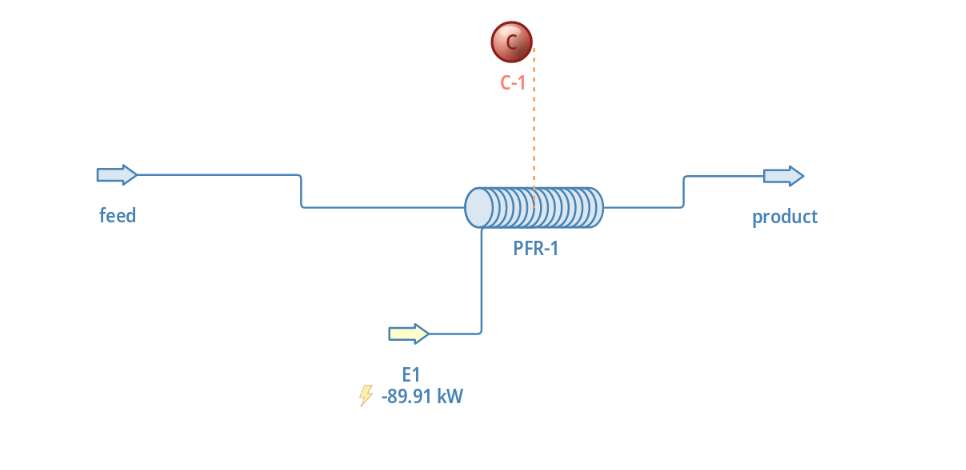

# Plug Flow Reactor (PFR) Simulation Using DWSIM

## 1. Project Overview
This project demonstrates the simulation and design of a Plug Flow Reactor (PFR) using DWSIM, an open-source chemical process simulator.

The objective is to determine the reactor volume required to achieve a specified conversion of the reactant.

## 2. Software Used
- DWSIM – Chemical Process Simulation Software

## 3. Reaction Details

**Reaction:**

Cis-2-butene → Trans-2-butene

- Reaction type: Isomerization
- Reactor: Plug Flow Reactor (PFR)
- Reaction phase: Liquid
- Kinetic model: Arrhenius
- Reaction order: First order
## 4. PFR Flowsheet

## 5. Simulation Results

## 6. Reaction Kinetics

- Reaction basis: Molar Concentration
- Forward reaction order: 1
- Reverse reaction order: 0
- Target conversion: 90%

## 7. Reactor Design Results

| Parameter | Value |
|---|---:|
| Reactor Volume | 1.54029 m³ |
| Tube Length | 1 m |
| Tube Diameter | 1.40042 m |
| Number of Tubes | 1 |
| Reaction Rate | 58.4304 kmol/(m³·h) |
| Reaction Heat | -90 kW |

## 8. Controller Implementation

A controller block was implemented to manipulate the PFR volume while controlling the conversion of Cis-2-butene.

The target conversion was specified as 0.90 (90%).

## 9. Learning Outcomes

- Understanding reaction kinetics and stoichiometry.
- Implementing Arrhenius kinetic models.
- Designing plug flow reactors.
- Understanding conversion and reaction rate.
- Using controller blocks for reactor design calculations.

## 10. Project Files

- DWSIM simulation file
- PFR flowsheet
- Reactor results and screenshots

## 9. Conclusion

The PFR simulation was successfully calculated in DWSIM. The calculated reactor volume was 1.54029 m³. The conversion target should be verified in the reactor Conversions tab.
