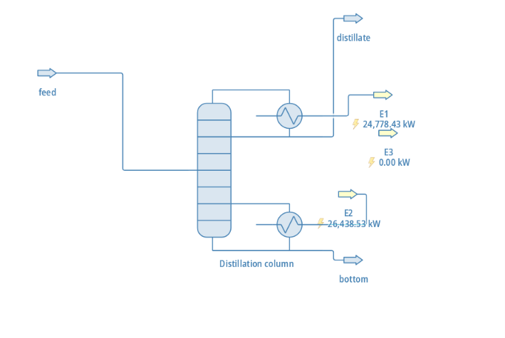

# Hydrocarbon Distillation Column Simulation

## 1. Project Overview

This project involves the simulation of a hydrocarbon distillation column using **DWSIM**, an open-source chemical process simulator.

The objective is to separate a five-component hydrocarbon mixture into lighter components in the distillate stream and heavier components in the bottoms stream.

## 2. Software Used

- DWSIM – Process Simulation
- Microsoft Excel – Results Analysis
- GitHub – Project Documentation and Version Control

## 3. Feed Composition

The feed consists of the following five hydrocarbon components:

| Component | Mole Fraction |
|---|---:|
| Propane | 0.05 |
| Isobutane | 0.10 |
| Isopentane | 0.40 |
| n-Hexane | 0.36 |
| n-Heptane | 0.09 |
| **Total** | **1.00** |

## 4. Feed Operating Conditions

| Parameter | Value | Unit |
|---|---:|---|
| Temperature | 30 | °C |
| Pressure | 1.40624 | bar |
| Molar Flow Rate | 2500 | kmol/h |
| Mass Flow Rate | 192295 | kg/h |

## 5. Simulation Results

The simulation produced the following column design estimates:

| Parameter | Value | Unit |
|---|---:|---|
| Minimum Reflux Ratio | 0.39505 | - |
| Minimum Number of Stages | 6.1199 | - |
| Actual Number of Stages | 8.85938 | - |
| Optimal Feed Stage | 4.5865 | - |
| Condenser Duty | 24778.4 | kW |
| Reboiler Duty | 26438.5 | kW |
| Estimated Column Height | 5.42969 | m |
| Estimated Column Diameter | 6.02802 | m |

## 6. Product Separation

The simulation shows the following separation trend:

- **Distillate:** Enriched in propane, isobutane and isopentane.
- **Bottoms:** Enriched in n-hexane and n-heptane.

## 7. Project Files

| File | Description |
|---|---|
| `hydrocarbon_distillation.dwxmz` | DWSIM simulation file |
| `results.xlsx` | Feed, stream and component distribution data |
| `flowsheet.png` | Process flowsheet screenshot |

## 8. Process Flowsheet

## 9. Key Learning Outcomes

- Understanding multicomponent distillation.
- Working with DWSIM process simulation software.
- Studying feed and product stream properties.
- Understanding reflux ratio and theoretical stages.
- Evaluating condenser and reboiler energy requirements.
- Performing material balance and component recovery calculations.

---

**Project Category:** Chemical Engineering | Process Simulation

**Simulation Software:** DWSIM